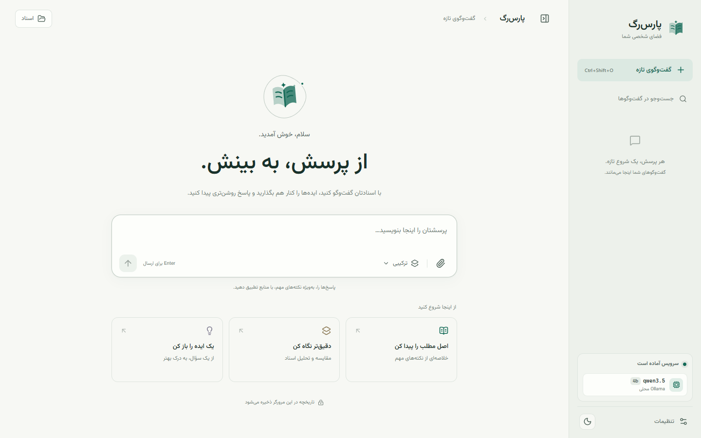
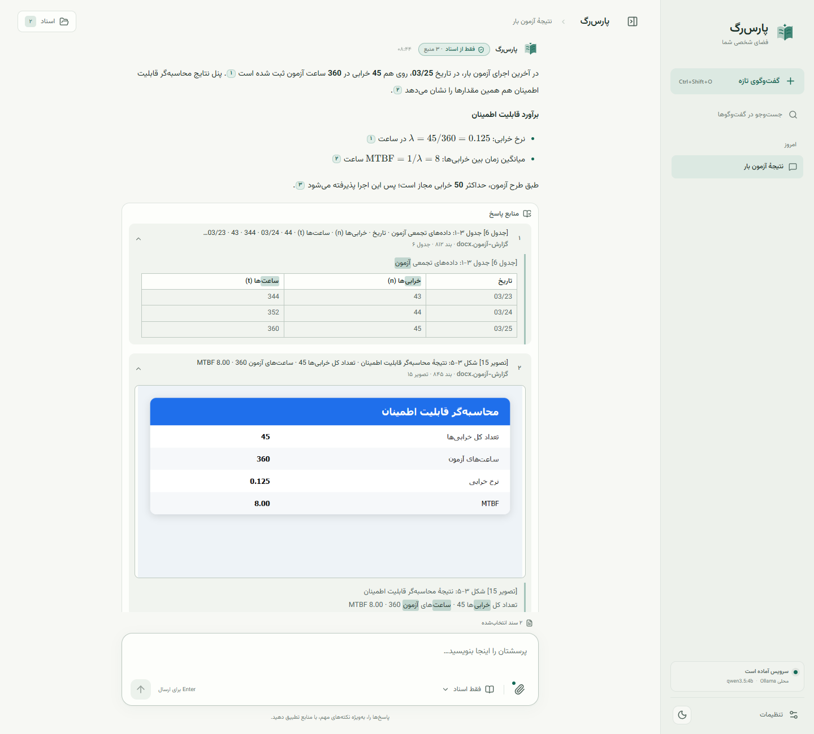
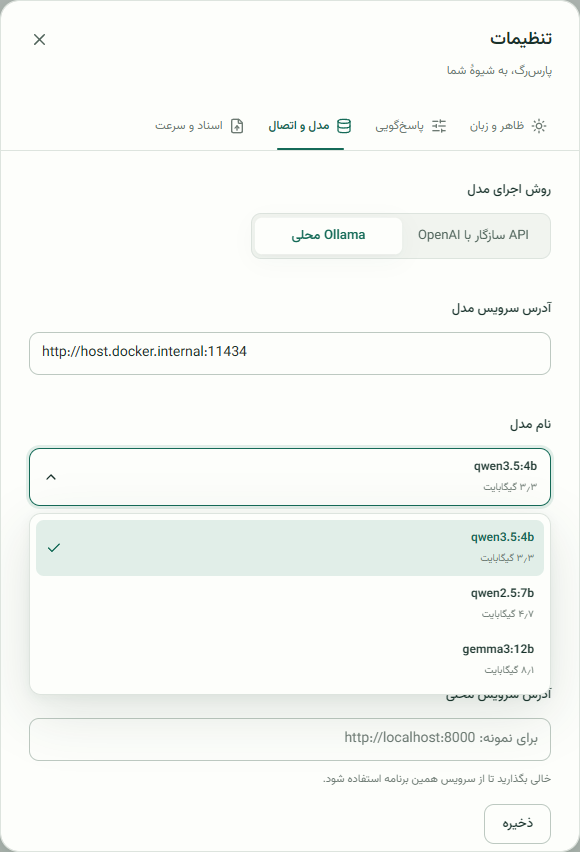
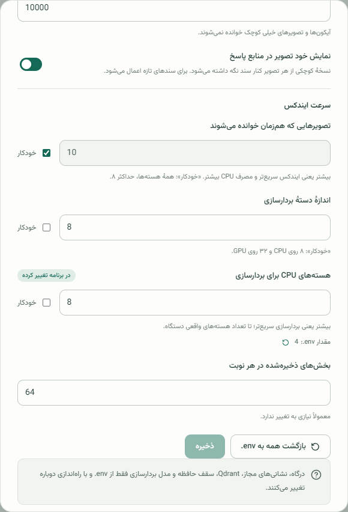
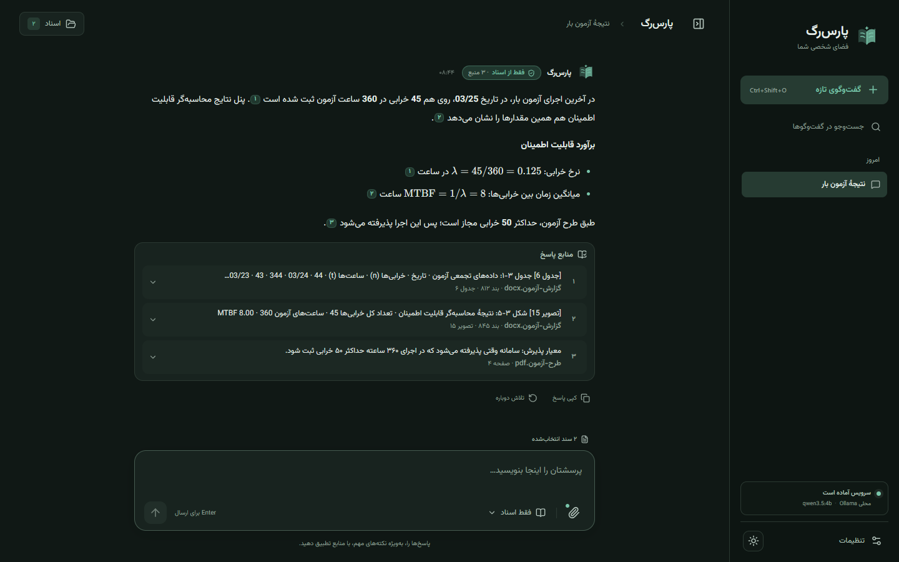
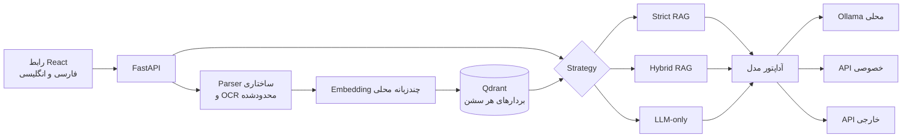

<p align="left"><strong>فارسی</strong> · <a href="README.md">English</a></p>

<p align="center">
  
</p>

<h1 align="center">پارس‌رگ (ParsRAG)</h1>

<p align="center">
  <strong>دستیار خصوصی اسناد، طراحی‌شده برای زبان فارسی</strong><br>
  چت با اسناد فارسی و انگلیسی با پاسخ‌های مستند و قابل‌ردیابی؛ RAG فارسی با مدل زبانی محلی
</p>

<p align="center"><a href="https://pooria82.github.io/ParsRAG-Landing/fa/">وب‌سایت پروژه</a></p>

<p align="center">
  <a href="LICENSE"></a>
  
  
  
</p>

پارس‌رگ یک فضای کاری دوزبانه و آفلاین‌محور برای پرسش و پاسخ مبتنی بر بازیابی
اطلاعات (RAG) روی اسناد فارسی و انگلیسی است: چت با PDF، Word، PowerPoint،
صفحه‌های اسکن‌شده، تصاویر و فایل‌های متنی.
استخراج متن، OCR با Tesseract، embedding چندزبانه، بازیابی با LlamaIndex و
جست‌وجوی برداری با Qdrant روی سیستم میزبان انجام می‌شوند.
برای تولید پاسخ می‌توان از مدل زبانی محلی با Ollama، یک API سازگار با OpenAI در شبکه خصوصی
یا یک سرویس خارجی استفاده کرد. هر گفت‌وگو اسناد، محدوده جست‌وجو، شاخه‌های
پاسخ، منابع و چرخه حذف مستقل خود را دارد.

## نمای رابط کاربری

گفت‌وگو، اسناد و عددهای تصاویر زیر نمونهٔ ساختگی هستند و از رابط برنامهٔ در حال
اجرا گرفته شده‌اند؛ هیچ سند خصوصی یا کلید API در آن‌ها دیده نمی‌شود. برای ساختن
دوبارهٔ آن‌ها در پوشهٔ `frontend` فرمان `npm run screenshots` را اجرا کنید.

<p align="center"><a href="docs/screenshots/home-fa-light.png"></a></p>

| پاسخ مستند با منبع جدول و تصویر | مدل‌های نصب‌شدهٔ Ollama |
| --- | --- |
| [](docs/screenshots/sources-fa-light.png) | [](docs/screenshots/model-fa-light.png) |
| **تنظیمات اسناد و سرعت** | **فضای کار در حالت تاریک** |
| [](docs/screenshots/settings-fa-light.png) | [](docs/screenshots/workspace-fa-dark.png) |

## قابلیت‌های اصلی

- **سه روش پاسخ‌دهی روشن:** فقط مبتنی بر سند، ترکیبی و فقط مبتنی بر دانش مدل.
- **ورودی‌های متنوع:** PDF، Word، PowerPoint، تصویر، متن، Markdown، JSON، CSV،
  HTML، XML، YAML، فایل‌های لاگ، تنظیمات و فرمت‌های رایج کد.
- **OCR هدفمند:** صفحات تصویری PDF و صفحه‌های دارای لایهٔ متن کوتاه و تصویر،
  تصاویر مستقل و تصاویر داخل DOCX و PPTX با داده‌های فارسی و انگلیسی Tesseract.
- **منابع قابل‌ردیابی:** نام یکتای فایل همراه با بازهٔ صفحه، اسلاید، پاراگراف، شمارهٔ
  جدول یا شمارهٔ تصویر. بخش‌های جدولی به شکل جدول نمایش داده می‌شوند و منبعی که از
  یک تصویر خوانده شده، خود تصویر را هم نشان می‌دهد.
- **مدیریت داده محلی:** جداسازی داده هر گفت‌وگو در Qdrant، حذف یک سند، برداشتن
  انتخاب همه اسناد، استفادهٔ دوباره از سند ایندکس‌شده در گفت‌وگوی دیگر بدون
  آپلود مجدد، و حذف کامل سشن.
- **پرسش دقیق:** با `@` به یک یا چند سند بارگذاری‌شده اشاره کنید و بخش‌های
  پرسش را به همان منابع مربوط کنید؛ با `/` دستورهای آماده را ببینید.
- **استفاده تطبیقی از سخت‌افزار:** از Ollamaی نصب‌شده روی رایانه با مدل‌ها و GPU
  آن استفاده کنید، یا Ollama را داخل Docker روی CPU، NVIDIA یا AMD سازگار اجرا
  کنید؛ تصویرها هنگام ایندکس به‌صورت موازی خوانده می‌شوند.
- **تنظیمات بدون راه‌اندازی دوباره:** تنظیمات مدل، بازیابی، OCR، بارگذاری و سرعت
  ایندکس از داخل برنامه تغییر می‌کنند؛ مقدار `.env` هرکدام نمایش داده می‌شود و
  می‌توان به آن برگشت.
- **کنترل مصرف منابع:** محدودیت برای آپلود، ابعاد تصویر OCR، آرشیو Office،
  هم‌زمانی، batchهای embedding و Qdrant و حافظه کانتینرها.
- **رابط حرفه‌ای فارسی و انگلیسی:** جهت مستقل محتوای پاسخ، چهار رنگ‌بندی،
  راهنمای آغازین با امکان رد کردن و نمایش دوباره، تنظیم مدل، نمایش
  مرحله‌های واقعی پردازش، نمایش تدریجی پاسخ، فرمول‌های ریاضی، ویرایش پرامپت،
  تولید دوباره پاسخ و شاخه‌بندی مکالمه.
- **فضای کار نصب‌پذیر:** PWA با آیکون اختصاصی و پوستهٔ رابطِ قابل بازشدن در
  حالت آفلاین؛ درخواست‌های مدل و داده‌های اسناد در کش Service Worker قرار نمی‌گیرند.

اطلاعات پیشنهادی برای بخش About و موضوع‌های GitHub در
[راهنمای دیده‌شدن ریپازیتوری](docs/repository-discovery.md) ثبت شده است.

## حالت‌های پاسخ‌دهی

| حالت | بازیابی سند | دانش مدل | کاربرد |
| --- | --- | --- | --- |
| **فقط سند (Strict)** | الزامی | طبق قرارداد پرامپت استفاده نمی‌شود | پاسخ‌هایی که باید فقط به اسناد انتخاب‌شده متکی باشند |
| **ترکیبی (Hybrid)** | الزامی و همراه با rerank | می‌تواند شواهد را تکمیل کند | توضیح و جمع‌بندی با اولویت سند |
| **فقط مدل (LLM-only)** | انجام نمی‌شود | مستقیماً استفاده می‌شود | گفت‌وگوی عمومی و مستقل از اسناد |

حالت Strict وقتی شواهد بازیابی‌شده به حدنصاب نرسند از پاسخ قطعی خودداری می‌کند.
این رفتار یک محافظ نرم‌افزاری است؛ پاسخ‌های مهم را با منابع نمایش‌داده‌شده تطبیق
دهید.
برای PDFهایی که از این نسخه به بعد ایندکس می‌شوند، یک قطعهٔ محدود از انتهای هر
صفحه و ابتدای صفحهٔ بعد نیز ایندکس می‌شود تا اطلاعات دو سوی مرز صفحه با ارجاع
به هر دو صفحه قابل‌بازیابی باشد. امتیاز برداریِ نزدیک به حدنصاب تنها وقتی
پذیرفته می‌شود که متن بازیابی‌شده واژه‌های شاخص پرسش را هم پشتیبانی کند.

**پس از ارتقا به 1.0.0:** اسنادی که با نسخه‌های قبلی ایندکس شده‌اند کار می‌کنند.
برای بهره‌بردن از یکسان‌سازی املای فارسی، بخش‌بندی سندهای Word بر اساس سرعنوان،
تشخیص فایل تکراری از روی محتوا، اتصال دو صفحه و استخراج متن و OCR بهبودیافته،
سند را حذف و دوباره بارگذاری کنید؛ استفادهٔ دوباره از ایندکس قدیمی آن را بازسازی
نمی‌کند. گفت‌وگوها در نخستین اجرا از `localStorage` به IndexedDB منتقل می‌شوند و
نخستین اجرا مدل رتبه‌بندی حالت ترکیبی را در حافظهٔ مدل‌ها دانلود می‌کند.

**پس از ارتقا به 1.1.0:** اسنادی که با 1.0.0 ایندکس شده‌اند کار می‌کنند. فایل‌های
Word و PowerPoint را دوباره بارگذاری کنید تا ارجاع به تصویر و جدول، نمایش تصویر
کنار منبع، خواندن تصویرهای بعد از سی‌امین و OCR بهتر اسکرین‌شات‌ها را داشته باشید.
تنظیماتی که در برنامه تغییر می‌دهید بر `.env` مقدم‌اند و می‌توان به مقدار `.env` برگشت.

در کادر پرسش `@` را تایپ کنید و سندی را که در همین گفت‌وگو ایندکس شده است
برگزینید. می‌توانید در یک پرسش چند سند را نام ببرید؛ برای نمونه:
`@{هزینه.pdf} مبلغ را بگو و @{زمان‌بندی.docx} تاریخ تحویل را بگو`.
هر بخش در سند نام‌برده جست‌وجو می‌شود و حالت فقط سند اگر برای یکی از آن‌ها
شواهد کافی نیابد، از پاسخ ترکیبی خودداری می‌کند. با تایپ `/` در ابتدای خط،
دستورهای خلاصه، مقایسه، ترجمه، طرح کلی، تغییر حالت پاسخ، اسناد و راهنما
نمایش داده می‌شوند. در بخش اسناد نیز می‌توانید سند ایندکس‌شدهٔ گفت‌وگوی قبلی
را بدون آپلود دوباره به گفت‌وگوی فعلی بیاورید. گفت‌وگوی مبدأ تا پایان کپی باید
وجود داشته باشد؛ پس از آن دو نسخه مستقل هستند.

تور آغازین اکنون تاریخچه، آپلود و استفادهٔ دوباره از اسناد، حالت‌های پاسخ،
ویرایش پرسش، منابع، تنظیمات مدل، حریم خصوصی و مدیریت داده را معرفی می‌کند.
می‌توانید آن را رد کنید یا از **تنظیمات ← ظاهر و زبان ← راهنمای فضای کار**
دوباره ببینید. همان صفحه میانبرهای متناسب با سیستم‌عامل شما را نشان می‌دهد:

| کار | ویندوز / لینوکس | مک |
| --- | --- | --- |
| گفت‌وگوی تازه | `Ctrl+Shift+O` | `⌘⇧O` |
| جست‌وجوی گفت‌وگوها | `Ctrl+Shift+K` | `⌘⇧K` |
| بازکردن اسناد | `Ctrl+Shift+D` | `⌘⇧D` |
| بازکردن تنظیمات | `Ctrl+,` | `⌘,` |
| رفتن به کادر پیام | `/` | `/` |
| نمایش تور | `Ctrl+Shift+H` | `⌘⇧H` |
| تغییر حالت روشن و تیره | `Ctrl+Shift+Y` | `⌘⇧Y` |

## فرمت‌های پشتیبانی‌شده

| خانواده | پسوندها | روش پردازش |
| --- | --- | --- |
| سند | `.pdf`، `.docx`، `.pptx` | استخراج ساختاری؛ OCR برای صفحات تصویری/کم‌متن PDF و تصاویر داخل Office |
| تصویر | `.png`، `.jpg`، `.jpeg`، `.webp`، `.bmp`، `.tif`، `.tiff` | اعتبارسنجی و OCR |
| متن و داده | `.txt`، `.md`، `.markdown`، `.json`، `.csv`، `.tsv`، `.log` | متن UTF-8، UTF-16 (با BOM) یا کدگذاری قدیمی ویندوز ۱۲۵۶ (فارسی) و ۱۲۵۲؛ اعتبارسنجی و نرمال‌سازی JSON |
| نشانه‌گذاری و تنظیمات | `.html`، `.htm`، `.xml`، `.yaml`، `.yml`، `.toml`، `.ini`، `.cfg` | متن قابل‌مشاهده یا UTF-8 |
| کد منبع | `.py`، `.js`، `.jsx`، `.ts`، `.tsx`، `.css`، `.sql` | استخراج UTF-8 با متادیتای بخش |

ظرفیت پیش‌فرض **۱۰ فایل در هر سشن**، **۱۰۰ مگابایت دودویی برای هر فایل** و
**۵۰۰ مگابایت دودویی در هر batch آپلود** است. فرانت‌اند محدودیت‌های واقعی را
از بک‌اند دریافت می‌کند؛ در نتیجه تغییر `.env` هم‌زمان در اعتبارسنجی و رابط
کاربر اعمال می‌شود. فایل‌های Office از نظر تعداد ورودی‌های آرشیو، حجم بازشده و
نسبت فشرده‌سازی مشکوک نیز بررسی می‌شوند.

## معماری و مرز اعتماد



| فراهم‌کننده | محل تولید پاسخ | داده‌ای که از پارس‌رگ خارج می‌شود |
| --- | --- | --- |
| Ollama محلی | همین سیستم | پرامپت یا متن بازیابی‌شده از آداپتور مدل خارج نمی‌شود |
| API خصوصی | سرور تحت کنترل شما | پرامپت و بخش‌های بازیابی‌شده در حالت‌های RAG |
| API خارجی | سرویس شخص ثالث | پرامپت و بخش‌های بازیابی‌شده در حالت‌های RAG |

Embedding و Qdrant در همه حالت‌ها محلی می‌مانند. کلید API فقط در حافظه پردازش
یا متغیر محیطی نگه‌داری می‌شود و در localStorage، لاگ، پاسخ API یا فایل تنظیمات
پایدار مدل ذخیره نمی‌شود. هر کلید فقط به نشانی‌ای فرستاده می‌شود که برای آن وارد
شده است. تنها درخواست دیگری که از سیستم بیرون می‌رود، بررسی روزانهٔ نسخهٔ تازه
است: خواندن بی‌نام فهرست عمومی ریلیزها از GitHub که می‌توان خاموشش کرد (بخش
«به‌روزرسانی»).

طراحی لایه‌ای بک‌اند (پورت‌ها، یوزکیس‌ها و DTOها) در
[ARCHITECTURE.md](ARCHITECTURE.md) و جزئیات ورود اسناد، ذخیره‌سازی برداری،
بازیابی و نگهداری داده در [DATA.md](DATA.md) توضیح داده شده است.

## اجرای سریع: راه‌اندازی کامل

راه‌اندازی پیشنهادی همهٔ قابلیت‌ها را فعال می‌کند:
- پاسخ با Ollamaی نصب‌شده روی همین رایانه، روی GPU آن و با مدل‌هایی که از قبل
  دارید؛
- جابه‌جایی به هر API سازگار با OpenAI (مثلاً Google AI Studio) از تنظیمات؛
- OCR برای اسکن‌ها، اسکرین‌شات‌ها و تصویرهای داخل Word و PowerPoint، همراه با
  نمایش خود تصویر کنار منبع پاسخ؛
- تغییر همهٔ تنظیمات رفتاری از داخل برنامه، بدون راه‌اندازی دوباره.

پیش‌نیازها: Docker Desktop (ویندوز و مک) یا Docker Engine و Compose (لینوکس)،
[Ollama](https://ollama.com/download) و ۸ تا ۱۶ گیگابایت RAM.

۱. Ollama را نصب کنید و یک مدل بگیرید. روی GPU حدود ۶ گیگابایتی، مدل ۳ تا ۴
میلیارد پارامتری کاملاً روی GPU اجرا می‌شود:

```bash
ollama pull gemma3:4b
```

۲. فایل تنظیمات را بسازید. پیش‌فرض‌های آن از همین Ollamaی رایانه استفاده
می‌کنند و فقط بخش ۱ (مدل) را باید ببینید؛ `LLM_MODEL_NAME` را نام مدلی بگذارید
که گرفتید:

```powershell
Copy-Item .env.example .env
```

(در مک و لینوکس: `cp .env.example .env`.)

۳. فقط در لینوکس: اجازه دهید کانتینرها به Ollama برسند (بخش
[لینوکس](#لینوکس-docker-engine)). ویندوز و مک کاری لازم ندارند.

۴. پارس‌رگ را اجرا کنید:

```bash
docker compose up -d --build
```

۵. نشانی `http://127.0.0.1:8000` (یا پورت `PARSRAG_PORT`) را باز کنید، سند
بارگذاری کنید و بپرسید. هنگام تولید پاسخ، `ollama ps` نشان می‌دهد مدل کجا اجرا
می‌شود؛ `100% GPU` یعنی همهٔ مدل روی GPU است:

```text
NAME          ID              SIZE      PROCESSOR    CONTEXT    UNTIL
gemma3:4b     68ceab7e468a    2.9 GB    100% GPU     4096       4 minutes from now
```

در برنامه، **تنظیمات** بقیهٔ موارد را در حین اجرا تغییر می‌دهد:
- **مدل و اتصال:** مدل نصب‌شدهٔ Ollama را از فهرست انتخاب کنید، یا با وارد
  کردن نشانی، نام مدل و کلید به یک API بروید. بخش «تنظیمات پیشرفتهٔ مدل»
  اندازهٔ متن، مهلت‌ها و تلاش دوباره را دارد.
- **پاسخ‌گویی:** آستانهٔ شواهد حالت فقط اسناد، عمق بازیابی و جست‌وجوی واژه‌ای.
- **اسناد و سرعت:** سقف بارگذاری، OCR، نمایش تصویر در منابع و سرعت ایندکس
  (تصویرهای هم‌زمان و هسته‌های CPU).

مقدارهایی که در تنظیمات ذخیره می‌شوند بر `.env` مقدم‌اند و پس از راه‌اندازی دوباره
هم می‌مانند؛ کنار هرکدام مقدار `.env` آمده و می‌توان به آن برگشت. فقط تنظیماتی
که راه‌اندازی دوباره لازم دارند یا از سرویس محافظت می‌کنند در `.env` می‌مانند:
پورت، نشانی‌های مجاز، Qdrant، سقف حافظه، بزرگ‌ترین درخواست بارگذاری و مدل
بردارسازی.

مدیریت سرویس‌ها:

```bash
docker compose ps
docker compose logs -f app
docker compose down
```

فرمان `docker compose down` داده volumeها را نگه می‌دارد. اجرای
`docker compose down -v` داده Qdrant، تنظیمات ذخیره‌شده، cache و وزن‌های Ollama را
حذف می‌کند.

### جزئیات Ollama سیستم

#### ویندوز و مک (Docker Desktop)

کار دیگری لازم نیست. Docker Desktop نشانی
`host.docker.internal` را به loopback سیستم می‌رساند، پس همان نشانی پیش‌فرض
Ollama یعنی `127.0.0.1:11434` کار می‌کند و Ollama از شبکه در دسترس نمی‌شود.
Docker نمی‌تواند GPU مک را به کانتینر بدهد، پس روی مک تنها راه اجرای مدل روی GPU
همین حالت است.

#### لینوکس (Docker Engine)

Compose نشانی `host.docker.internal` را به دروازهٔ
پل Docker (`host-gateway`، معمولاً `172.17.0.1`) نگاشت می‌کند. Ollama به‌طور
پیش‌فرض فقط روی `127.0.0.1` گوش می‌دهد و کانتینرها به آن نمی‌رسند. سرویس Ollama
را روی نشانی پل تنظیم کنید:

```bash
ip -4 addr show docker0          # نشانی را یادداشت کنید؛ معمولاً 172.17.0.1
sudo systemctl edit ollama.service
```

```ini
[Service]
Environment="OLLAMA_HOST=172.17.0.1:11434"
```

```bash
sudo systemctl daemon-reload
sudo systemctl restart ollama
curl http://172.17.0.1:11434/api/tags
OLLAMA_HOST=172.17.0.1:11434 ollama ps
```

با این نشانی، فرمان `ollama` روی خود سیستم هم باید همین `OLLAMA_HOST` را داشته
باشد. `OLLAMA_HOST=0.0.0.0:11434` هم کار می‌کند، اما Ollama را روی همهٔ شبکه‌هایی
که رایانه به آن‌ها وصل است باز می‌کند. Ollama احراز هویت ندارد و هر کسی که به این
درگاه برسد می‌تواند از مدل‌ها و GPU شما استفاده کند. اگر `0.0.0.0` را انتخاب
کردید، درگاه را فقط برای شبکه‌های Docker باز کنید و هرگز روی شبکهٔ عمومی از آن
استفاده نکنید. با `ufw`:

```bash
sudo ufw allow from 172.16.0.0/12 to any port 11434 proto tcp
sudo ufw deny 11434/tcp
```

دیواره‌آتشی که ترافیک شبکه‌های Docker را می‌بندد هم به شکل «Ollama پاسخ نداد»
دیده می‌شود؛ درگاه 11434 را مانند بالا برای زیرشبکه‌های Docker باز کنید.

#### مدل‌های موجود

Ollama مدل‌ها را در مسیری که `OLLAMA_MODELS` نشان می‌دهد
نگه می‌دارد. مسیرهای پیش‌فرض:
- ویندوز: `%USERPROFILE%\.ollama\models`
- مک: `~/.ollama/models`
- سرویس لینوکس: `/usr/share/ollama/.ollama/models`

اگر مسیر را عوض کرده‌اید (مثلاً `OLLAMA_MODELS=E:\.ollama\models` در ویندوز)، همین
متغیر را برای سرویس Ollama نگه دارید. پارس‌رگ در این حالت هیچ مدلی دانلود
نمی‌کند، چون `ollama-init` فقط در پروفایل `local-model` اجرا می‌شود.

#### حافظهٔ GPU

- برنامه `OLLAMA_CONTEXT_LENGTH` (پیش‌فرض `8192`) را با هر درخواست به Ollama
  می‌فرستد، پس Ollama سیستم فقط همین اندازه حافظه برای متن می‌گیرد.
- اندازه‌گیری روی کارت RTX 3060 لپ‌تاپ با ۶ گیگابایت حافظه، در حالی که خود
  ویندوز حدود ۱٫۶ گیگابایت از آن را گرفته بود:
  - مدل پیش‌فرض `gemma3:4b` (۲٫۹ گیگابایت) با `OLLAMA_CONTEXT_LENGTH=4096`
    کاملاً روی GPU (`100% GPU`) اجرا شد. در ۱۲ پرسش از گزارش‌های خود پروژه، ۱۸
    پاسخ از ۲۴ پاسخ درست بود و میانهٔ زمان هر پاسخ ۷٫۴ ثانیه بود.
  - `qwen3.5:4b` (۳٫۳ گیگابایت) با `OLLAMA_CONTEXT_LENGTH=4096` کاملاً روی GPU
    (`100% GPU`) اجرا شد و در چند ثانیه پاسخ داد.
  - `qwen2.5:7b` (۴٫۷ گیگابایت) حتی با متن ۲۰۴۸ توکنی حدود `82%` روی GPU
    ماند؛ کار می‌کند ولی کندتر است.
- روی چنین کارت‌هایی:
  - مدل ۳ تا ۴ میلیارد پارامتری بردارید.
  - `OLLAMA_CONTEXT_LENGTH=4096` بگذارید.
  - بردارسازی را روی CPU نگه دارید. ایمیج پایه همین کار را می‌کند، پس فایل
    GPU اضافه نکنید.
- فایل `compose.gpu-low-vram.yaml` برای Ollama داخل Docker است. در این حالت،
  فایل پایه خودش تنظیم مناسب VRAM کم است.
- روی سیستم NVIDIA با VRAM کافی، افزودن `-f compose.gpu.yaml` بردارسازی را هم
  به GPU می‌برد. تنظیمات `ollama` در آن فایل فقط با پروفایل اعمال می‌شود.

#### مدل‌های «فکرکننده»

پارس‌رگ از Ollama می‌خواهد پیش از پاسخ «فکر» نکند
(`OLLAMA_THINK=0`). وگرنه مدل‌هایی مثل `qwen3`، `qwen3.5` یا `deepseek-r1`
ممکن است همهٔ بودجهٔ پاسخ را صرف استدلال کنند و پاسخ خالی برگردانند.
`OLLAMA_THINK=1` را فقط همراه با `OLLAMA_CONTEXT_LENGTH` بزرگ‌تر به کار ببرید.

#### جابه‌جایی مدل

در تنظیمات → مدل:
- «Ollama محلی» را انتخاب کنید. نشانی پیش‌فرض همان نشانی سرور یعنی
  `http://host.docker.internal:11434` است و «یافتن مدل‌های نصب‌شده» مدل‌های
  سیستم را نشان می‌دهد.
- یا «API سازگار با OpenAI» را انتخاب کنید.

تغییر از پرسش بعدی و بدون راه‌اندازی دوباره اعمال می‌شود.

#### نشانی‌های مجاز Ollama

نشانی Ollama باید ساده و به شکل `http://host:port`
باشد، روی یکی از این میزبان‌ها:
- `localhost`، `127.0.0.1` یا `::1`
- `ollama`
- `host.docker.internal`
- میزبانی که در `OLLAMA_ALLOWED_HOSTS` می‌نویسید (با ویرگول جدا، مثلاً یک
  سرور GPU در شبکهٔ محلی)

نام کاربری، مسیر، پارامتر و HTTPS پذیرفته نمی‌شوند. برای موارد دیگر از گزینهٔ
API سازگار با OpenAI استفاده کنید.

#### رفع اشکال

| نشانه | علت و راه‌حل |
| --- | --- |
| تنظیمات: «Ollama در این آدرس پاسخ نداد» | Ollama اجرا نمی‌شود، یا در لینوکس روی پل Docker گوش نمی‌دهد یا دیواره‌آتش آن را می‌بندد (بالا را ببینید). از داخل کانتینر بیازمایید: `docker compose exec app python -c "import httpx; print(httpx.get('http://host.docker.internal:11434/api/tags').status_code)"` |
| تنظیمات: «این آدرس Ollama مجاز نیست» | از `http://` با یکی از میزبان‌های مجاز استفاده کنید یا میزبان را به `OLLAMA_ALLOWED_HOSTS` بیفزایید |
| پس از تغییر `.env` برنامه هنوز مدل یا نشانی قبلی را به کار می‌برد | اتصالی که در تنظیمات ذخیره شده بر `.env` مقدم است؛ Ollama سیستم را دوباره در تنظیمات انتخاب کنید |
| «مدل انتخاب‌شده پیدا نشد» | `LLM_MODEL_NAME` باید با نامی در `ollama list` یکی باشد |
| `ollama ps` به‌جای GPU، `CPU` یا تقسیم CPU/GPU نشان می‌دهد | درایور GPU را به‌روز کنید، مدل کوچک‌تری بردارید یا `OLLAMA_CONTEXT_LENGTH` را کم کنید |
| هنگام شروع برنامه Ollama خاموش بود | برنامه باز هم آماده می‌شود؛ تا وقتی Ollama روشن نشود پرسش‌ها پیام «سرویس مدل در دسترس نیست» می‌گیرند و بعد بدون راه‌اندازی دوباره کار می‌کنند |

## روش‌های دیگر اجرا

وقتی راه‌اندازی کامل مناسب نیست (Ollama روی سیستم نیست، فقط API دارید یا
Ollama را داخل Docker می‌خواهید) از این روش‌ها استفاده کنید.

### استفاده از API مدل

مقادیر زیر را در `.env` تنظیم کنید:

```dotenv
LLM_PROVIDER=api
LLM_MODEL_NAME=your-model-id
MODEL_API_BASE_URL=https://provider.example/v1
MODEL_API_KEY=your-runtime-secret
MODEL_API_DISCLOSURE_ACKNOWLEDGED=1
```

API خصوصی سازگار با OpenAI می‌تواند بدون کلید باشد. آدرس‌های عمومی باید HTTPS
باشند، اما loopback و شبکه خصوصی می‌توانند از HTTP استفاده کنند.
برای API خارجی، فقط پس از پذیرش ارسال پرسش‌ها و بخش‌های مرتبط اسناد، مقدار
`MODEL_API_DISCLOSURE_ACKNOWLEDGED` را `1` بگذارید. در تنظیمات برنامه نیز همین
تأیید هنگام انتخاب API ثبت می‌شود.

سطح رایگان Google AI Studio از راه نشانی سازگار با OpenAI آن کار می‌کند (کلید را از
aistudio.google.com بگیرید). مدل `gemini-flash-lite-latest` در چند ثانیه پاسخ می‌دهد و
برای استفادهٔ روزمره جا دارد؛ در آزمونی با ۵۲ پرسش فارسی، ۸۳٪ پرسش‌ها را کامل پاسخ داد.
`gemini-3-flash-preview` قوی‌تر است، اما سطح رایگانش برای هر مدل فقط حدود ۲۰ درخواست در روز
می‌پذیرد:

```dotenv
LLM_PROVIDER=api
LLM_MODEL_NAME=gemini-flash-lite-latest
MODEL_API_BASE_URL=https://generativelanguage.googleapis.com/v1beta/openai/
MODEL_API_KEY=your-ai-studio-key
MODEL_API_DISCLOSURE_ACKNOWLEDGED=1
```

مدل‌های Gemma (مثل `gemma-4-26b-a4b-it`) هم کار می‌کنند، اما سطح رایگان برای آن‌ها فقط
۱۶٬۰۰۰ توکن ورودی در دقیقه می‌پذیرد؛ `MODEL_CONTEXT_WINDOW=12000` یا کمتر بگذارید و
انتظار حدود یک پرسش در دقیقه را داشته باشید.

پیشوند `models/` که این سرویس لازم دارد خودکار اضافه می‌شود و استدلال مدل
(`<thought>...</thought>`) از پاسخ حذف می‌شود. سطح‌های رایگان گاهی با خطای ۵۰۰ یا ۴۲۹
پاسخ نمی‌دهند؛ پارس‌رگ این درخواست‌ها را تا `MODEL_API_MAX_RETRIES` بار (پیش‌فرض ۴)
دوباره می‌فرستد و برای محدودیت نرخ تا یک دقیقه صبر می‌کند. سرویس‌دهنده ممکن است از
پرسش‌های سطح رایگان استفاده کند؛ برای اسناد محرمانه از آن استفاده نکنید.

```powershell
docker compose up -d --build
```

### اجرای Ollama روی CPU

مدلی متناسب با RAM سیستم انتخاب کنید:

```dotenv
LLM_PROVIDER=ollama
LLM_MODEL_NAME=gemma3:4b
OLLAMA_MODEL=gemma3:4b
OLLAMA_DOCKER_BASE_URL=http://ollama:11434
```

متغیر `OLLAMA_DOCKER_BASE_URL` برنامه را به‌جای Ollamaی نصب‌شده روی رایانه، که
پیش‌فرض `.env.example` است، به کانتینر Ollama وصل می‌کند.

```powershell
docker compose --profile local-model up -d qdrant ollama
docker compose --profile local-model run --rm ollama-init
docker compose --profile local-model up -d --build app
```

مدل فقط یک‌بار در volume به نام `ollama_models` دانلود می‌شود. اجرای CPU روی
همه سیستم‌ها ممکن است اما برای مدل‌های بزرگ کند است؛ در سیستم ضعیف از مدل
quantized کوچک‌تر یا API استفاده کنید.

### اجرای Ollama و embedding روی NVIDIA GPU

در میزبان Docker باید درایور به‌روز NVIDIA و پشتیبانی NVIDIA Container Toolkit
فعال باشد. مقادیر `.env` بخش CPU را هم (از جمله `OLLAMA_DOCKER_BASE_URL`)
تنظیم کنید و overlay زیر را در همه فرمان‌های مرتبط وارد کنید:

```powershell
docker compose -f compose.yaml -f compose.gpu.yaml --profile local-model config --quiet
docker compose -f compose.yaml -f compose.gpu.yaml --profile local-model up -d qdrant ollama
docker compose -f compose.yaml -f compose.gpu.yaml --profile local-model run --rm ollama-init
docker compose -f compose.yaml -f compose.gpu.yaml --profile local-model up -d --build app
```

سپس هر دو مسیر شتاب‌دهی را بررسی کنید:

```powershell
docker compose -f compose.yaml -f compose.gpu.yaml exec app python -c "import torch; print(torch.cuda.is_available(), torch.cuda.get_device_name(0))"
docker compose -f compose.yaml -f compose.gpu.yaml exec ollama ollama run gemma3:4b "Reply with exactly GPU_OK"
docker compose -f compose.yaml -f compose.gpu.yaml exec ollama ollama ps
```

کارت‌هایی با حدود ۶ گیگابایت VRAM ممکن است نتوانند مدل embedding و مدل مولد 7B
را هم‌زمان به‌طور کامل در حافظه نگه دارند. اگر `ollama ps` ترکیب CPU/GPU را
نشان داد، با overlay کم‌حافظه، تولید پاسخ را در اولویت GPU قرار دهید و embedding
را روی CPU نگه دارید:

```powershell
docker compose -f compose.yaml -f compose.gpu.yaml -f compose.gpu-low-vram.yaml --profile local-model up -d app ollama
docker compose -f compose.yaml -f compose.gpu.yaml -f compose.gpu-low-vram.yaml exec ollama ollama ps
```

این overlay مقدار پیش‌فرض context را نیز به ۲۰۴۸ token کاهش می‌دهد. فقط زمانی
`OLLAMA_LOW_VRAM_CONTEXT_LENGTH` را بیشتر کنید که مدل و VRAM بدون offload ظرفیت
آن را داشته باشند. این overlay حاشیه آزاد VRAM را صفر می‌کند؛ اگر محیط دسکتاپ
به حافظه رزروشده نیاز دارد، overlay را بردارید یا
`OLLAMA_LOW_VRAM_FIT_TARGET` را افزایش دهید.

image برنامه از PyTorch 2.13 و wheel رسمی CUDA 12.6 استفاده می‌کند و Compose کارت
NVIDIA را برای هر دو سرویس `app` و `ollama` رزرو می‌کند. برای آماده‌سازی میزبان
به [راهنمای GPU در Docker Compose](https://docs.docker.com/compose/how-tos/gpu-support/)،
[راهنمای Docker در Ollama](https://github.com/ollama/ollama/blob/main/docs/docker.mdx)
و [راهنمای GPU در Ollama](https://github.com/ollama/ollama/blob/main/docs/gpu.mdx)
مراجعه کنید.

### اجرای AMD در میزبان‌های پشتیبانی‌شده

overlay مربوط به AMD برای Linux و ROCm طراحی شده و `/dev/kfd` و `/dev/dri` را
در اختیار کانتینرها می‌گذارد. پیش از اجرا، مقادیر `.env` بخش CPU را تنظیم کنید:

```bash
docker compose -f compose.yaml -f compose.amd.yaml --profile local-model config --quiet
docker compose -f compose.yaml -f compose.amd.yaml --profile local-model up -d --build
```

این حالت از image مخصوص ROCm در Ollama و PyTorch 2.6 با wheelهای ROCm 6.2 استفاده
می‌کند تا نسخهٔ جدیدتر ROCm روی سخت‌افزار AMD آزموده شود. سازگاری کارت و درایور را
پیش از استقرار بررسی کنید؛ برای سخت‌افزار
پشتیبانی‌نشده از پروفایل CPU یا API مدل استفاده کنید.

### دسترسی دستگاه‌های دیگر به برنامه

API فقط به نام‌های `localhost`، `127.0.0.1` و `::1` پاسخ می‌دهد. اگر با
`PARSRAG_BIND_HOST` برنامه را روی رابط شبکهٔ دیگری در دسترس می‌گذارید، نام یا
آدرسی را که با آن برنامه را باز می‌کنید در `PARSRAG_ALLOWED_HOSTS` (با کاما جدا)
بنویسید؛ درخواست با نام‌های دیگر پاسخ `400 Host is not trusted` می‌گیرد.

## تنظیم کارایی و حافظه

تنظیمات دارای ⚙ را می‌توان در حین اجرا از **تنظیمات** برنامه هم تغییر داد؛ بقیه
پس از راه‌اندازی دوباره از `.env` اعمال می‌شوند.

| متغیر | پیش‌فرض | کاربرد |
| --- | --- | --- |
| `PARSRAG_APP_MEMORY_LIMIT` | `6g` | سقف حافظه کانتینر برنامه |
| `QDRANT_MEMORY_LIMIT` | `2g` | سقف حافظه Qdrant |
| `OLLAMA_MEMORY_LIMIT` | `12g` | سقف حافظه Ollama |
| `PARSRAG_CPU_THREADS` ⚙ | `4` | تعداد threadهای CPU برای PyTorch/OpenMP؛ تا تعداد هسته‌های واقعی، ایندکس را سریع‌تر می‌کند |
| `OCR_WORKERS` ⚙ | هسته‌های CPU (حداکثر ۸) | تصویرهایی که هنگام ایندکس هم‌زمان خوانده می‌شوند؛ متن حاصل همان خواندن تک‌به‌تک است |
| `EMBED_DEVICE` | `auto` | دستگاه embedding؛ overlay انویدیا آن را `cuda` می‌کند |
| `EMBED_BATCH_SIZE` ⚙ | `8` | batch embedding؛ در GPU مقدار پیش‌فرض `32` است |
| `QDRANT_UPSERT_BATCH_SIZE` ⚙ | `64` | اندازه batch محدودشده برای ثبت بردارها |
| `OLLAMA_MAX_LOADED_MODELS` | `1` | تعداد مدل‌های هم‌زمان در حافظه |
| `OLLAMA_NUM_PARALLEL` | `1` | تعداد generationهای هم‌زمان Ollama |
| `OLLAMA_KEEP_ALIVE` | `5m` | مدت نگه‌داشتن وزن مدل در حافظه |
| `OLLAMA_CONTEXT_LENGTH` ⚙ | `8192` | context درخواستی از Ollama (`num_ctx`)؛ بخش‌های بازیابی‌شده برای جاشدن کوتاه می‌شوند. overlay کم‌حافظه مقدار `2048` دارد |
| `OLLAMA_THINK` ⚙ | `0` | اجازهٔ «فکر کردن» به مدل‌های فکرکننده پیش از پاسخ؛ context بزرگ‌تری لازم دارد |
| `MODEL_CONTEXT_WINDOW` ⚙ | `32768` | context فرضی مدل‌های API برای جادادن بخش‌های بازیابی‌شده |
| `LLM_REQUEST_TIMEOUT_SECONDS` ⚙ | `120` | زمان یک درخواست پاسخ؛ برای تکرار درخواست، `MODEL_API_MAX_RETRIES` را ببینید |
| `MODEL_API_MAX_RETRIES` ⚙ | `4` | تکرار درخواست API پس از خطای 5xx یا 429 (برای 429 تا یک دقیقه صبر) |
| `CONDENSE_TIMEOUT_SECONDS` ⚙ | `30` | بازنویسی پرسش پیگیری؛ پس از این زمان همان پرسش اصلی استفاده می‌شود |

برای سیستم‌های کم‌حافظه batch و concurrency را کاهش دهید. محدودیت حافظه
کانتینر سقف مصرف است؛ مدل محلی همچنان باید در RAM یا VRAM موجود جا شود.

## تنظیمات آپلود و OCR

همهٔ این موارد جز `OCR_MAX_IMAGE_PIXELS` و `PARSRAG_MAX_REQUEST_BYTES` از
**تنظیمات ← اسناد و سرعت** هم قابل تغییرند.

| متغیر | پیش‌فرض | کاربرد |
| --- | --- | --- |
| `PARSRAG_MAX_FILES_PER_SESSION` | `10` | کل اسناد یک گفت‌وگو |
| `PARSRAG_MAX_FILE_BYTES` | `104857600` | ۱۰۰ MiB برای هر فایل |
| `PARSRAG_MAX_BATCH_BYTES` | `524288000` | ۵۰۰ MiB برای هر batch |
| `PARSRAG_MAX_REQUEST_BYTES` | `534773760` | سقف body شامل سربار multipart |
| `PARSRAG_TMPFS_SIZE` | `576m` | حجم `/tmp` مبتنی بر RAM در Docker که فایل‌ها هنگام درخواست آپلود در آن نگه داشته می‌شوند؛ دست‌کم به اندازهٔ `PARSRAG_MAX_REQUEST_BYTES` |
| `OCR_ENABLED` | `1` | فعال‌سازی مسیرهای Tesseract |
| `OCR_LANGUAGES` | `fas+eng` | زبان‌های OCR |
| `OCR_DPI` | `200` | وضوح تصویرسازی صفحه‌های اسکن‌شده PDF |
| `OCR_ORIENTATION` | `1` | بازخوانی صفحه‌های چرخیده یا وارونه (تشخیص جهت Tesseract) و صفحه‌های کج‌شده از ۲ درجه به بالا؛ `0` آن را خاموش می‌کند |
| `OCR_MAX_PAGES` | `30` | تعداد صفحه‌های اسکن‌شدهٔ PDF که با OCR خوانده می‌شود؛ صفحه‌های بعدی کنار گذاشته و در فهرست سند اعلام می‌شوند |
| `OCR_MAX_IMAGES` | `200` | تعداد تصویرهای داخل DOCX/PPTX که با OCR خوانده می‌شود؛ تصویرهای بعدی با اعلان کنار گذاشته می‌شوند |
| `OCR_MAX_IMAGE_PIXELS` | `40000000` | محافظ ابعاد بازشده تصویر |
| `OCR_TIMEOUT_SECONDS` | `45` | timeout هر صفحه یا تصویر |
| `OCR_DOCUMENT_TIMEOUT_SECONDS` | `900` | زمان کل OCR یک سند؛ صفحه‌ها و تصویرهای باقی‌مانده با هشدار کنار گذاشته می‌شوند |
| `SOURCE_IMAGE_PREVIEWS` | `1` | نگه‌داشتن نسخهٔ WebP (حداکثر ۱۲۸۰ پیکسل) از هر تصویر خوانده‌شده تا کنار منبع پاسخ نمایش داده شود |

## ویندوز، مک و لینوکس

پیکربندی CPU در Docker Compose پایهٔ قابل‌حمل روی هر سه سیستم‌عامل است.
با `docker compose up -d --build` اجرا کنید و برای سرویس Ollama کانتینری
پروفایل `local-model` را اضافه کنید. برای استفاده از Ollama نصب‌شده
روی خود رایانه (با مدل‌ها و GPU آن، از جمله Apple Silicon) بخش
[اجرای سریع: راه‌اندازی کامل](#اجرای-سریع-راه‌اندازی-کامل) را ببینید. Docker
Desktop روی مک، GPU میزبان را در اختیار کانتینر لینوکسی Ollama نمی‌گذارد؛
overlayهای NVIDIA و AMD برای میزبان‌های پشتیبانی‌شدهٔ ویندوز و لینوکس‌اند.
استفاده از API سازگار با OpenAI نیز برای سیستم فاقد مدل محلی ممکن است.
[توضیح Docker دربارهٔ GPU و Ollama](https://docs.docker.com/guides/rag-ollama/).

در CI، بک‌اند و فرانت‌اند روی ویندوز، مک و لینوکس بررسی می‌شوند؛ ساخت Docker
و آزمون مرورگر روی لینوکس انجام می‌شود. نصب اولیه را روی سیستم مقصد نیز، به‌ویژه
برای بسته‌های زبان OCR و دسترسی GPU، بررسی کنید.

## توسعه مستقیم روی ویندوز

به Python 3.12، Node.js 22، Qdrant و Ollama یا یک endpoint سازگار با OpenAI
نیاز دارید. برای OCR نیز Tesseract همراه با زبان‌های `fas` و `eng` لازم است.

فایل `.env.example` را به `.env` کپی کنید و علامت `#` را از سطرهای بخش
«Running without Docker» در انتهای آن بردارید (نشانی Qdrant، نشانی Ollama، فایل
تنظیمات و `OCR_ENABLED=1`)؛ Compose این‌ها را خودش تنظیم می‌کند.

```powershell
py -3.12 -m venv .venv
.\.venv\Scripts\python.exe -m pip install -r requirements-runtime.txt -c requirements.lock

Set-Location frontend
npm ci
npm run build
Set-Location ..

.\.venv\Scripts\python.exe -m uvicorn backend.main:app --host 127.0.0.1 --port 8000
```

در macOS یا Linux، فرمان‌های Python بالا به شکل زیر هستند:

```sh
python3.12 -m venv .venv
.venv/bin/python -m pip install -r requirements-runtime.txt -c requirements.lock
.venv/bin/python -m uvicorn backend.main:app --host 127.0.0.1 --port 8000
```

برای ساخت رابط، `cd frontend && npm ci && npm run build` را اجرا کنید.
Qdrant را جداگانه بالا بیاورید و پیش از بررسی `/health/ready` آدرس Ollama
یا API سازگار را تنظیم کنید.

برای hot reload در پوشه `frontend` فرمان `npm run dev` را اجرا کنید. Vite تمام
خانواده‌ مسیرهای API را به `http://127.0.0.1:8000` proxy می‌کند. فقط برای توسعه
محلی و در صورت نیاز، `ENVIRONMENT=development` را در `.env` قرار دهید.

## سلامت سرویس، ماندگاری و اجرای آفلاین

- `/health/live` زنده بودن فرایند وب را اعلام می‌کند.
- `/health/ready` پس از آماده‌شدن مدل و Qdrant کد `200` می‌دهد؛ هنگام دانلود یا
  آماده‌سازی اولیه، پاسخ `503 {"status":"preparing"}` طبیعی است.
- `/capabilities` فرمت‌ها و محدودیت‌های مؤثر آپلود را به رابط اعلام می‌کند.
- گفت‌وگوها، شاخه‌ها و منابع پاسخ در IndexedDB مرورگر ذخیره می‌شوند (داده‌های
  قبلی `localStorage` در نخستین اجرا به آن منتقل می‌شوند)؛ تنظیمات رابط در
  `localStorage` می‌ماند.
- متن‌های chunkشده و بردارها با شناسه سشن در Qdrant قرار می‌گیرند.
- cache مدل embedding، داده Qdrant، مدل‌های Ollama و تنظیمات غیرمحرمانه مدل در
  volumeهای جداگانه نگه‌داری می‌شوند.
- پس از دانلود اولیه imageها و وزن مدل، حالت Ollama محلی می‌تواند آفلاین بماند.

### به‌روزرسانی

برنامه روزی یک بار، بدون فرستادن اطلاعاتی از شما یا اسنادتان، از GitHub می‌پرسد نسخهٔ تازه‌ای منتشر شده است یا نه. GitHub فقط نشانی‌ای را می‌بیند که درخواست از آن آمده است. این بررسی را در **تنظیمات ← عمومی ← نسخه و به‌روزرسانی** یا با `UPDATE_CHECK_ENABLED=0` خاموش کنید. وقتی نسخهٔ تازه‌ای بیاید، نوار کناری آن را نشان می‌دهد و پنجره‌اش تغییرات همهٔ نسخه‌های تازه‌تر را فهرست می‌کند.

برای به‌روزرسانی، اول از همان پنجره فایل پشتیبان گفت‌وگوها را دریافت کنید، چون گفت‌وگوها در مرورگر ذخیره‌اند. بعد در پوشهٔ ParsRAG این دستور را اجرا کنید:

```bash
sh scripts/update.sh
```

در ویندوز:

```bash
powershell -ExecutionPolicy Bypass -File scripts/update.ps1
```

- اگر فایل‌های این نسخه تغییر کرده باشند، اسکریپت متوقف می‌شود.
- از `.env`، ایندکس اسناد (Qdrant) و تنظیمات مدل در پوشهٔ `backups/<تاریخ>-v<نسخه>/` پشتیبان می‌گیرد و راهنمای بازگردانی را در `RESTORE.txt` می‌نویسد.
- مستقیم به آخرین نسخه می‌رود. نسخه‌های میانی نصب نمی‌شوند، ولی تغییراتشان بعداً نشان داده می‌شود.
- برنامه را با همان فایل‌ها و پروفایل Compose دوباره می‌سازد و صبر می‌کند تا سرویس آماده شود. اگر ساخت به خطا بخورد، نسخهٔ قبلی را دوباره راه می‌اندازد.
- صفحهٔ باز خودش رابط تازه را بارگیری می‌کند، بی‌آنکه لازم باشد cache را دستی پاک کنید، و تغییرات را نشان می‌دهد.

اسکریپت به یک `git clone` از مخزن نیاز دارد. از نسخهٔ 1.1.1 یا قدیمی‌تر، یک بار دستی با `git pull` و `docker compose up -d --build` به‌روزرسانی کنید.

### نصب به‌صورت برنامه

نسخهٔ بیلدشده را در `http://127.0.0.1:8000/` باز کنید. اگر مرورگر امکان نصب
را ارائه کرد، از گزینهٔ نصب مرورگر یا **تنظیمات ← ظاهر و زبان ← نصب برنامه**
استفاده کنید. پنجرهٔ نصب‌شده به گفت‌وگوها و تنظیمات همین پروفایل مرورگر دسترسی
دارد. پوستهٔ رابط بدون اتصال هم باز می‌شود، ولی آپلود، ایندکس و پاسخ‌گویی
همچنان به بک‌اند محلی و سرویس مدل نیاز دارند. Service Worker پاسخ‌های API،
پرامپت‌ها، اسناد و کلیدها را ذخیره نمی‌کند. نسخهٔ تازهٔ رابط با پیشنهاد
بارگیری دوباره اعمال می‌شود و هنگام آپلود یا دریافت پاسخ منتظر می‌ماند.

برای دسترسی از دستگاه دیگر، برنامه را با HTTPS ارائه کنید؛ Service Worker
به محیط امن نیاز دارد و localhost استثنای توسعه است. سرور توسعه
(`npm run dev`) عمداً Service Worker را فعال نمی‌کند.

## کنترل‌های کیفیت

```powershell
.\.venv\Scripts\python.exe -m ruff format --check backend
.\.venv\Scripts\python.exe -m ruff check backend
.\.venv\Scripts\python.exe -m mypy backend --strict
.\.venv\Scripts\python.exe -m pytest -q backend/tests

Set-Location frontend
npm test
npm run build
npm run test:e2e
npm run test:pwa
Set-Location ..

docker compose config --quiet
docker compose -f compose.yaml -f compose.gpu.yaml --profile local-model config --quiet
docker compose -f compose.yaml -f compose.gpu.yaml -f compose.gpu-low-vram.yaml --profile local-model config --quiet
docker compose -f compose.yaml -f compose.amd.yaml --profile local-model config --quiet
```

فرمان `pytest` ساده دو آزمون سرتاسری (end-to-end) را رد می‌کند. این دو آزمون مسیر
کامل بارگذاری تا پاسخ را با پردازش و بردارسازی واقعی و Qdrant درون‌حافظه‌ای اجرا
می‌کنند و بار اول مدل بردارسازی را دانلود می‌کنند. برای اجرای همهٔ آزمون‌ها بدون
هیچ آزمون ردشده:

```powershell
$env:PARSRAG_E2E = "1"; .\.venv\Scripts\python.exe -m pytest
```

این متغیر تا پایان همان پنجرهٔ PowerShell می‌ماند و با `Remove-Item Env:PARSRAG_E2E`
پاک می‌شود. برای آزمون روی سرور Qdrant (مثل CI)، یک Qdrant جدا اجرا کنید و
`QDRANT_HOST` را به آن بدهید. Qdrant استک Compose روی میزبان باز نیست:

```powershell
docker run -d --rm --name qdrant-e2e -p 127.0.0.1:6333:6333 qdrant/qdrant:v1.19.1
$env:PARSRAG_E2E = "1"; $env:QDRANT_HOST = "localhost"; .\.venv\Scripts\python.exe -m pytest backend/tests/e2e --no-cov
docker stop qdrant-e2e
```

فایل‌های خصوصی تست باید در `testData/` و خروجی آزمایش‌های موقت در `scratch/`
بمانند. هر دو مسیر در Git نادیده گرفته می‌شوند و نباید کامیت شوند.

## اسناد پروژه

- [نسخه انگلیسی README](README.md)
- [معماری سیستم](ARCHITECTURE.md) و نقشه‌های [جریان داده](docs/architecture/data-flow.md)، [یوزکیس‌ها](docs/architecture/use-cases.md) و [DTOها](docs/architecture/dtos.md) (انگلیسی)
- [راهنمای داده، ورود اسناد و RAG](DATA.md) (انگلیسی)
- [سوابق تصمیم‌های معماری](.context/)
- [هویت بصری و قواعد حرکت](frontend/BRAND.md)
- [نقشه راه](.context/05_Implementation_Roadmap.md): مرحله‌های انجام‌شده، ایرادهای شناخته‌شده، بهبودها و برنامه‌های آینده
- [سیاست امنیت](SECURITY.md)
- [راهنمای مشارکت](CONTRIBUTING.md)
- [روش استناد به پارس‌رگ](CITATION.cff)
- [فهرست تغییرات](CHANGELOG.md)

## مجوز

پارس‌رگ یک نرم‌افزار **source-available است و متن‌باز محسوب نمی‌شود**.
[مجوز پارس‌رگ](LICENSE) دانلود و اجرای نسخه رسمی و تغییریافته‌نشده را برای
استفاده شخصی، دانشگاهی، پژوهشی، آموزشی و داخلی سازمان مجاز می‌کند. بازنشر،
تغییر برند، ارائه به‌عنوان سرویس و تغییر بدون اجازه ممنوع است. تغییرات فقط برای
ارسال Pull Request به همین مخزن و مطابق
[توافق مشارکت‌کنندگان](CONTRIBUTOR_LICENSE_AGREEMENT.md) قابل آماده‌سازی هستند.
برای هر استفاده دیگر باید از صاحب اثر اجازه کتبی گرفته شود.
