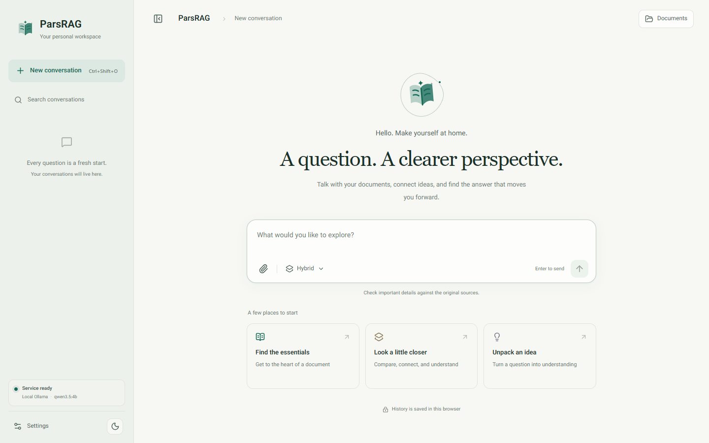
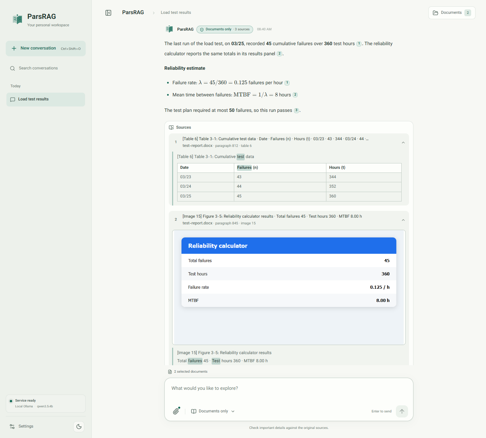
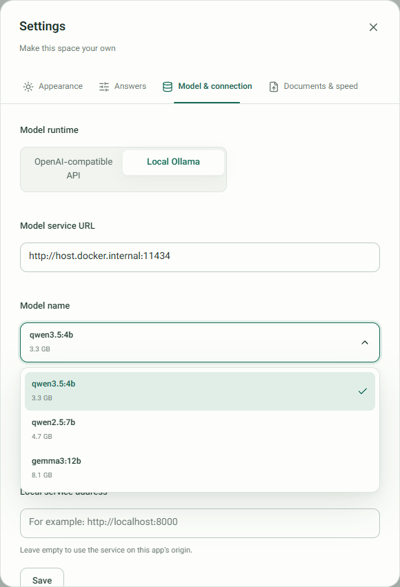
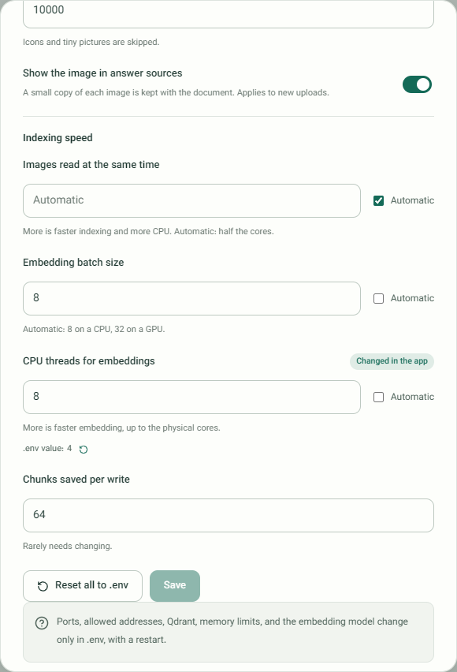
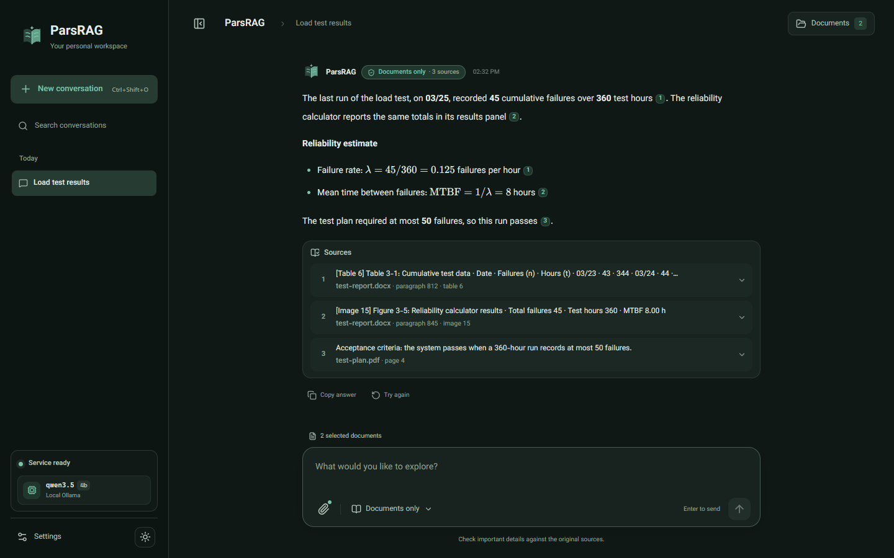
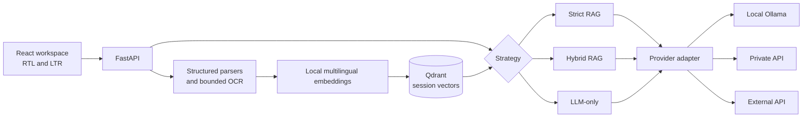

<p align="right"><a href="README.fa.md">فارسی</a> · <strong>English</strong></p>

<p align="center">
  
</p>

<h1 align="center">ParsRAG</h1>

<p align="center">
  <strong>Private document intelligence, designed for Persian.</strong><br>
  Chat with Persian (Farsi) and English documents and get cited, traceable answers.
</p>

<p align="center"><a href="https://pooria82.github.io/ParsRAG-Landing/">Project website</a></p>

<p align="center">
  <a href="LICENSE"></a>
  
  
  
</p>

ParsRAG is a bilingual, offline-first retrieval-augmented generation (RAG)
workspace for chatting with Persian (Farsi) and English documents: PDF, Word
(DOCX), PowerPoint (PPTX), scanned pages, images, and text files. Parsing,
Tesseract OCR, multilingual-e5 embeddings, LlamaIndex retrieval, and Qdrant
vector search run on the host. Answers come from a local LLM through Ollama, a
private OpenAI-compatible endpoint, or an external API when local hardware is
unavailable. Every conversation has its own documents, retrieval scope, answer
branches, cited sources, and deletion lifecycle.

## Interface preview

The conversation, documents, and numbers below are synthetic examples captured
from the running application. No private documents or API credentials appear in
these images. Regenerate them with `npm run screenshots` in `frontend`.

<p align="center"><a href="docs/screenshots/home-en-light.png"></a></p>

| Grounded answer: table and image sources | Installed Ollama models |
| --- | --- |
| [](docs/screenshots/sources-en-light.png) | [](docs/screenshots/model-en-light.png) |
| **Documents & speed settings** | **Dark workspace** |
| [](docs/screenshots/settings-en-light.png) | [](docs/screenshots/workspace-en-dark.png) |

## Highlights

- **Three explicit answer modes:** Strict document-only RAG, Hybrid RAG, and
  model-only chat.
- **Broad ingestion:** PDF, DOCX, PPTX, images, text, Markdown, JSON, CSV, HTML,
  XML, YAML, logs, configuration files, and common source-code formats.
- **OCR where it matters:** scanned and image-heavy PDF pages with sparse text
  layers, standalone images, and images embedded in Word or PowerPoint files,
  with Persian and English Tesseract data.
- **Traceable sources:** unique filenames plus page ranges, slides, paragraphs,
  tables, or image numbers. Table excerpts render as tables, and a source read
  from a picture shows the picture itself.
- **Local lifecycle:** Qdrant data is isolated by conversation; users can remove
  one document, deselect all documents, reuse an indexed document in another
  conversation without uploading it again, or delete an entire session.
- **Precise prompts:** mention one or several uploaded files with `@` to bind
  parts of a question to those sources; use `/` for quick prompt and mode actions.
- **Adaptive compute:** use the Ollama installed on the computer, with its
  models and GPU, or Ollama inside Docker on CPU, NVIDIA, or supported AMD
  hosts; images are read in parallel while indexing.
- **Settings without restarts:** model, retrieval, OCR, upload, and indexing
  settings change in the app; each shows its `.env` value and can be reset.
- **Resource controls:** bounded uploads, OCR dimensions, parser archives,
  concurrency, embedding batches, Qdrant upserts, and container memory.
- **Polished bilingual UI:** RTL/LTR content direction, four color palettes,
  a skippable and replayable first-run tour, model settings,
  progressive answers, real processing stages, math rendering, prompt editing,
  retries, and conversation branches.
- **Installable workspace:** a PWA manifest, project-owned icons, and an offline
  interface shell; model requests and document data are never service-worker cached.

Maintainers can use the [repository discovery settings](docs/repository-discovery.md)
for the GitHub About panel after publishing changes.

## Answer modes

| Mode | Retrieval | Model knowledge | Intended use |
| --- | --- | --- | --- |
| **Strict** | Required | Excluded by prompt contract | Answers that must remain grounded in selected documents |
| **Hybrid** | Required and reranked | May supplement evidence | Explanations and synthesis with document priority |
| **LLM-only** | Bypassed | Used directly | General chat unrelated to uploaded documents |

Strict mode refuses when retrieved evidence does not meet its configured
threshold. This is an application safeguard, not a universal guarantee; verify
important outputs against the displayed sources.
For newly indexed PDFs, a bounded excerpt joins each pair of consecutive pages,
so a fact split by a page turn can be retrieved with a two-page citation.
Borderline semantic matches are considered only when the retrieved text also
contains the question's distinctive terms; unrelated material still fails closed.

**After upgrading to 1.0.0:** documents indexed by earlier versions keep
working. Remove and upload them again to gain Persian spelling normalization,
heading-based Word chunks, content-based duplicate detection, page-boundary
excerpts, and the improved PDF text and OCR; reusing an old index does not
rebuild it. Conversations move from `localStorage` to IndexedDB on first start,
and the first start downloads the Hybrid reranker into the model cache.

**After upgrading to 1.1.0:** documents indexed by 1.0.0 keep working. Upload
Word and PowerPoint files again to gain image and table citations, image
previews next to sources, images past the 30th, and better OCR of screenshots.
Settings changed in the app take precedence over `.env` and can be reset to it.

In the composer, type `@` to choose a document already indexed in the current
conversation. You can mention more than one file, for example:
`@{budget.pdf} What is the cost? And @{timeline.docx} When is delivery?`
Each clause is searched in its named file; strict mode declines a combined
answer if either file lacks sufficient evidence. Type `/` at the beginning of
a line to choose a summary, comparison, translation, outline, mode change,
document action, or help action. The document panel can also copy an indexed
file from an earlier local conversation without another upload. Keep the source
conversation until the copy completes; afterwards, the two copies are independent.

The first-run tour now walks through conversation history, document upload and
reuse, answer modes, prompt editing, sources, model settings, privacy, and data
controls. Skip it or replay it from **Settings → Appearance → Workspace tour**.
The same settings page lists shortcuts for the current operating system:

| Action | Windows / Linux | macOS |
| --- | --- | --- |
| New conversation | `Ctrl+Shift+O` | `⌘⇧O` |
| Search conversations | `Ctrl+Shift+K` | `⌘⇧K` |
| Open documents | `Ctrl+Shift+D` | `⌘⇧D` |
| Open settings | `Ctrl+,` | `⌘,` |
| Focus the message box | `/` | `/` |
| Show the tour | `Ctrl+Shift+H` | `⌘⇧H` |
| Switch light/dark | `Ctrl+Shift+Y` | `⌘⇧Y` |

## Supported inputs

| Family | Extensions | Processing |
| --- | --- | --- |
| Documents | `.pdf`, `.docx`, `.pptx` | Native structured extraction; OCR for scanned/sparse image PDF pages and embedded images |
| Images | `.png`, `.jpg`, `.jpeg`, `.webp`, `.bmp`, `.tif`, `.tiff` | Validated and OCR-processed |
| Text and data | `.txt`, `.md`, `.markdown`, `.json`, `.csv`, `.tsv`, `.log` | UTF-8, UTF-16 (with BOM), or legacy Windows-1256 (Persian) / Windows-1252 text; JSON is validated and normalized |
| Markup/config | `.html`, `.htm`, `.xml`, `.yaml`, `.yml`, `.toml`, `.ini`, `.cfg` | Visible text or UTF-8 extraction |
| Source code | `.py`, `.js`, `.jsx`, `.ts`, `.tsx`, `.css`, `.sql` | UTF-8 extraction with section metadata |

Default capacity is **10 files per session**, **100 MiB per file**, and **500
MiB per upload batch**. The frontend discovers the effective limits from the
backend, so environment overrides stay synchronized with validation and UI.
Office archives are also checked for entry count, expanded size, and suspicious
compression ratios. Unsupported binary formats are rejected instead of being
silently misread.

## Architecture and trust boundary



| Provider | Generation location | Data leaving ParsRAG |
| --- | --- | --- |
| Local Ollama | This workstation | No prompt or excerpt leaves through the model adapter |
| Private API | A server you control | Prompt and retrieved excerpts in RAG modes |
| External API | A third-party service | Prompt and retrieved excerpts in RAG modes |

Embeddings and Qdrant remain local in all modes. API keys stay in process memory
or environment variables; they are not written to browser storage, logs, API
responses, or the persisted non-secret model configuration.

The layered backend design (ports, use cases, and DTOs) is described in
[ARCHITECTURE.md](ARCHITECTURE.md). Ingestion, vector storage, retrieval, and
retention are described in [DATA.md](DATA.md).

## Quick start: the complete setup

The recommended setup uses every capability:
- answers from the Ollama already installed on your computer, on its GPU, with
  the models you already have;
- switching to any OpenAI-compatible API (for example Google AI Studio) from
  Settings;
- OCR for scans, screenshots, and pictures inside Word and PowerPoint, with
  each cited image shown next to its source;
- every behaviour setting adjustable in the app, without a restart.

Requirements: Docker Desktop (Windows, macOS) or Docker Engine with Compose
(Linux), [Ollama](https://ollama.com/download), and 8–16 GB RAM.

1. Install Ollama and pull a model. On a GPU with about 6 GB of memory, a
   3–4B model runs fully on the GPU:

   ```bash
   ollama pull gemma3:4b
   ```

2. Create the settings file. Its defaults already use the Ollama on this
   computer; only section 1 (the model) needs attention, so set
   `LLM_MODEL_NAME` to the model you pulled:

   ```powershell
   Copy-Item .env.example .env
   ```

   (`cp .env.example .env` on macOS and Linux.)

3. Linux only: let containers reach Ollama, as described in
   [Linux](#linux-docker-engine). Windows and macOS need nothing.

4. Start ParsRAG:

   ```bash
   docker compose up -d --build
   ```

5. Open `http://127.0.0.1:8000` (or the port in `PARSRAG_PORT`), upload
   documents, and ask. While an answer is generated, `ollama ps` shows where
   the model runs; `100% GPU` means the GPU is used fully:

   ```text
   NAME          ID              SIZE      PROCESSOR    CONTEXT    UNTIL
   gemma3:4b     68ceab7e468a    2.9 GB    100% GPU     4096       4 minutes from now
   ```

In the app, **Settings** changes everything else while ParsRAG runs:
- **Model & connection:** pick an installed Ollama model from the list, or
  switch to an API by entering its address, model, and key. The Advanced section
  holds the context sizes, timeouts, and retries.
- **Answers:** the documents-only evidence threshold, retrieval depth, and
  keyword search.
- **Documents & speed:** upload limits, OCR, image previews, and indexing speed
  (images read at the same time, CPU threads).

Values saved in Settings take precedence over `.env` and survive restarts; each
shows its `.env` value and can be reset to it. Only settings that need a
restart or protect the service stay in `.env`: ports, allowed addresses, Qdrant,
memory limits, the largest upload request, and the embedding model.

Manage the stack:

```bash
docker compose ps
docker compose logs -f app
docker compose down
```

`docker compose down` keeps named volumes. `docker compose down -v` permanently
removes local vector data, persisted settings, caches, and Ollama weights.

### System Ollama in detail

#### Windows and macOS (Docker Desktop)

Nothing else is needed. Docker Desktop
forwards `host.docker.internal` to the host's loopback, so Ollama's default
`127.0.0.1:11434` works and Ollama stays closed to the network. Docker cannot
pass a Mac's GPU to a container, so on a Mac this host mode is the way to
generate on the GPU.

#### Linux (Docker Engine)

Compose maps `host.docker.internal` to the Docker
bridge gateway (`host-gateway`, usually `172.17.0.1`). Ollama listens only on
`127.0.0.1` by default, so containers cannot reach it. Make the Ollama service
listen on the bridge address:

```bash
ip -4 addr show docker0          # note the address, usually 172.17.0.1
sudo systemctl edit ollama.service
```

```ini
[Service]
Environment="OLLAMA_HOST=172.17.0.1:11434"
```

```bash
sudo systemctl daemon-reload
sudo systemctl restart ollama
curl http://172.17.0.1:11434/api/tags
OLLAMA_HOST=172.17.0.1:11434 ollama ps
```

With a bridge-only address, the `ollama` command on the host needs the same
`OLLAMA_HOST`. `OLLAMA_HOST=0.0.0.0:11434` also works, but it opens Ollama to
every network the computer is on. Ollama has no authentication, so anyone who
reaches the port can use your models and GPU. If you use `0.0.0.0`, allow the
port only from Docker's networks and never on a public network. With `ufw`:

```bash
sudo ufw allow from 172.16.0.0/12 to any port 11434 proto tcp
sudo ufw deny 11434/tcp
```

A host firewall that drops traffic from Docker networks also shows up as
"Ollama did not answer"; allow port 11434 from the Docker subnets as above.

#### Existing models

Ollama keeps models where `OLLAMA_MODELS` points. The
defaults are:
- Windows: `%USERPROFILE%\.ollama\models`
- macOS: `~/.ollama/models`
- Linux service: `/usr/share/ollama/.ollama/models`

If you moved them (for example `OLLAMA_MODELS=E:\.ollama\models` on Windows),
keep that variable set for the Ollama service. ParsRAG never pulls models in
this mode: `ollama-init` belongs to the `local-model` profile.

#### GPU memory

- The app passes `OLLAMA_CONTEXT_LENGTH` (default `8192`) to Ollama with every
  request, so the host's Ollama allocates only that context.
- Measured on a 6 GB RTX 3060 Laptop GPU, with the desktop using about 1.6 GB:
  - `gemma3:4b` (2.9 GB, the default) runs at `100% GPU` with
    `OLLAMA_CONTEXT_LENGTH=4096`. On 12 questions over the project's own
    reports it answered 18 of 24 correctly, with a median of 7.4 s per answer.
  - `qwen3.5:4b` (3.3 GB) runs at `100% GPU` with `OLLAMA_CONTEXT_LENGTH=4096`
    and answers in seconds.
  - `qwen2.5:7b` (4.7 GB) stays at about `82%` GPU, even with a 2048-token
    context. It works, but more slowly.
- On such cards:
  - Use a 3–4B model.
  - Set `OLLAMA_CONTEXT_LENGTH=4096`.
  - Keep embeddings on the CPU. The base image already does this, so add no
    GPU overlay.
- `compose.gpu-low-vram.yaml` tunes the Ollama container. In host mode, the
  base file already is the low-VRAM setup.
- On NVIDIA hosts with spare VRAM, adding `-f compose.gpu.yaml` moves
  embeddings to the GPU too. Its `ollama` settings apply only with the
  profile.

#### Thinking models

ParsRAG asks Ollama not to "think" before answering
(`OLLAMA_THINK=0`). Otherwise models such as `qwen3`, `qwen3.5`, or
`deepseek-r1` can spend the whole answer budget on reasoning and return an
empty answer. Set `OLLAMA_THINK=1` only together with a larger
`OLLAMA_CONTEXT_LENGTH`.

#### Switching models

In Settings → Model:
- Choose *Local Ollama*. The address defaults to the server's
  `http://host.docker.internal:11434`. *Find installed models* lists the
  host's models.
- Or choose *OpenAI-compatible API*.

Changes apply to the next question without a restart.

#### Allowed Ollama addresses

Ollama URLs must be plain `http://host:port` on:
- `localhost`, `127.0.0.1`, or `::1`
- `ollama`
- `host.docker.internal`
- a host you list in `OLLAMA_ALLOWED_HOSTS` (comma-separated, for example a
  GPU server on your LAN)

Credentials, paths, query strings, and HTTPS URLs are rejected. Use the
OpenAI-compatible API option for anything else.

#### Troubleshooting

| Symptom | Cause and fix |
| --- | --- |
| Settings: "Ollama did not answer at this address" | Ollama is not running, or on Linux it does not listen on the Docker bridge or a firewall blocks it (see above). Test from the app container: `docker compose exec app python -c "import httpx; print(httpx.get('http://host.docker.internal:11434/api/tags').status_code)"` |
| Settings: "This Ollama address is not allowed" | Use `http://` with one of the allowed hosts, or add the host to `OLLAMA_ALLOWED_HOSTS` |
| The app still uses the old model or URL after editing `.env` | A connection saved in Settings takes precedence over `.env`; choose the host Ollama again in Settings |
| "The selected model was not found" | `LLM_MODEL_NAME` must match a name in `ollama list` |
| `ollama ps` shows `CPU` or a CPU/GPU split | Update the GPU driver, use a smaller model, or lower `OLLAMA_CONTEXT_LENGTH` |
| Ollama was off when the app started | The app still becomes ready; questions report that the model service is unreachable until Ollama starts, then work without a restart |

## Other ways to run

Use these when the complete setup does not fit: no Ollama on the host, a model
API only, or Ollama inside Docker.

### Use an API model

Edit `.env`:

```dotenv
LLM_PROVIDER=api
LLM_MODEL_NAME=your-model-id
MODEL_API_BASE_URL=https://provider.example/v1
MODEL_API_KEY=your-runtime-secret
MODEL_API_DISCLOSURE_ACKNOWLEDGED=1
```

Private OpenAI-compatible services can omit the key. Public endpoints require
HTTPS; loopback and private-network endpoints may use HTTP.
Set the disclosure flag to `1` only after accepting that an external API receives
prompts and retrieved document excerpts. The Settings screen records the same
acknowledgement when configuring an API interactively.

Google AI Studio's free tier works through its OpenAI-compatible endpoint
(the key comes from aistudio.google.com). `gemini-flash-lite-latest` answers
in a few seconds and has room for everyday use; on a 52-question Persian test
it answered 83% of questions completely. `gemini-3-flash-preview` is stronger,
but its free tier allows only about 20 requests a day per model:

```dotenv
LLM_PROVIDER=api
LLM_MODEL_NAME=gemini-flash-lite-latest
MODEL_API_BASE_URL=https://generativelanguage.googleapis.com/v1beta/openai/
MODEL_API_KEY=your-ai-studio-key
MODEL_API_DISCLOSURE_ACKNOWLEDGED=1
```

Gemma models (`gemma-4-26b-a4b-it`) also work, but the free tier allows them
only 16,000 input tokens a minute: set `MODEL_CONTEXT_WINDOW=12000` or lower,
and expect about one question a minute.

The `models/` prefix that this endpoint requires is added automatically, and
model reasoning (`<thought>...</thought>`) is removed from answers. Free tiers
fail some requests with HTTP 500 or 429; ParsRAG retries those up to
`MODEL_API_MAX_RETRIES` times (default 4), waiting up to a minute for rate
limits. Prompts sent on a free tier may be used by the provider; avoid it for
confidential documents.

```powershell
docker compose up -d --build
```

### Run Ollama on CPU

Choose a model that fits the machine:

```dotenv
LLM_PROVIDER=ollama
LLM_MODEL_NAME=gemma3:4b
OLLAMA_MODEL=gemma3:4b
OLLAMA_DOCKER_BASE_URL=http://ollama:11434
```

`OLLAMA_DOCKER_BASE_URL` points the app at the Ollama container instead of the
Ollama installed on the computer, which `.env.example` uses by default.

```powershell
docker compose --profile local-model up -d qdrant ollama
docker compose --profile local-model run --rm ollama-init
docker compose --profile local-model up -d --build app
```

The model is downloaded once into the `ollama_models` volume. CPU inference is
portable but can be slow; smaller quantized models or an API endpoint are often
better on machines without a suitable GPU.

### Run Ollama and embeddings on NVIDIA GPU

Install a current NVIDIA driver and NVIDIA Container Toolkit support in the
Docker host, and set the `.env` values from the CPU section above (including
`OLLAMA_DOCKER_BASE_URL`). Then use the overlay for every related Compose
command:

```powershell
docker compose -f compose.yaml -f compose.gpu.yaml --profile local-model config --quiet
docker compose -f compose.yaml -f compose.gpu.yaml --profile local-model up -d qdrant ollama
docker compose -f compose.yaml -f compose.gpu.yaml --profile local-model run --rm ollama-init
docker compose -f compose.yaml -f compose.gpu.yaml --profile local-model up -d --build app
```

Verify both acceleration paths:

```powershell
docker compose -f compose.yaml -f compose.gpu.yaml exec app python -c "import torch; print(torch.cuda.is_available(), torch.cuda.get_device_name(0))"
docker compose -f compose.yaml -f compose.gpu.yaml exec ollama ollama run gemma3:4b "Reply with exactly GPU_OK"
docker compose -f compose.yaml -f compose.gpu.yaml exec ollama ollama ps
```

Cards with about 6 GB VRAM may not hold the embedding model and a 7B generator
at the same time. If `ollama ps` reports CPU/GPU splitting, prioritize generation
on the GPU and keep embeddings on CPU with the low-VRAM overlay:

```powershell
docker compose -f compose.yaml -f compose.gpu.yaml -f compose.gpu-low-vram.yaml --profile local-model up -d app ollama
docker compose -f compose.yaml -f compose.gpu.yaml -f compose.gpu-low-vram.yaml exec ollama ollama ps
```

This also lowers the default Ollama context to 2048 tokens. Override
`OLLAMA_LOW_VRAM_CONTEXT_LENGTH` only when the model and available VRAM can
support a larger context without layer offload. The overlay sets Ollama's free
VRAM fit target to zero; remove the overlay or increase
`OLLAMA_LOW_VRAM_FIT_TARGET` if the desktop needs reserved VRAM.

The app image uses PyTorch 2.13 with the official CUDA 12.6 wheel index. Compose reserves
the NVIDIA device for both `app` and `ollama`. See the official
[Docker Compose GPU guide](https://docs.docker.com/compose/how-tos/gpu-support/),
[Ollama Docker guide](https://github.com/ollama/ollama/blob/main/docs/docker.mdx),
and [Ollama GPU guide](https://github.com/ollama/ollama/blob/main/docs/gpu.mdx)
when preparing a new host.

### Run on supported AMD GPU hosts

The AMD overlay targets Linux ROCm hosts and maps `/dev/kfd` and `/dev/dri`.
Set the `.env` values from the CPU section above first:

```bash
docker compose -f compose.yaml -f compose.amd.yaml --profile local-model config --quiet
docker compose -f compose.yaml -f compose.amd.yaml --profile local-model up -d --build
```

It uses the ROCm Ollama image and pins PyTorch 2.6 with ROCm 6.2 wheels until
the newer ROCm runtime is validated on AMD hardware. Check GPU and driver
compatibility before deployment; unsupported hardware falls back poorly and
should use the CPU profile or an API provider.

### Open the app to other devices

The API answers only to `localhost`, `127.0.0.1`, and `::1`. If you bind the
app to another interface with `PARSRAG_BIND_HOST`, list the names or addresses
you will open it with in `PARSRAG_ALLOWED_HOSTS` (comma-separated); other host
names receive `400 Host is not trusted`.

## Performance and memory tuning

The settings marked ⚙ can also be changed in **Settings** while ParsRAG runs;
the rest apply from `.env` after a restart.

| Variable | Default | Effect |
| --- | --- | --- |
| `PARSRAG_APP_MEMORY_LIMIT` | `6g` | App container memory ceiling |
| `QDRANT_MEMORY_LIMIT` | `2g` | Qdrant memory ceiling |
| `OLLAMA_MEMORY_LIMIT` | `12g` | Ollama memory ceiling |
| `PARSRAG_CPU_THREADS` ⚙ | `4` | PyTorch/OpenMP CPU threads; up to the physical cores speeds up indexing |
| `OCR_WORKERS` ⚙ | the CPU cores (max 8) | Images read at the same time while indexing; the text is the same as one by one |
| `EMBED_DEVICE` | `auto` | Embedding device; GPU overlay sets `cuda` |
| `EMBED_BATCH_SIZE` ⚙ | `8` | Embedding batch; GPU overlay defaults to `32` |
| `QDRANT_UPSERT_BATCH_SIZE` ⚙ | `64` | Bounded vector insertion batch |
| `OLLAMA_MAX_LOADED_MODELS` | `1` | Limits concurrently resident models |
| `OLLAMA_NUM_PARALLEL` | `1` | Limits parallel Ollama generations |
| `OLLAMA_KEEP_ALIVE` | `5m` | Duration model weights remain loaded |
| `OLLAMA_CONTEXT_LENGTH` ⚙ | `8192` | Context requested from Ollama (`num_ctx`); retrieved chunks are trimmed to fit. Low-VRAM overlay uses `2048` |
| `OLLAMA_THINK` ⚙ | `0` | Let thinking models reason before answering; needs a larger context |
| `MODEL_CONTEXT_WINDOW` ⚙ | `32768` | Context assumed for API models when fitting retrieved chunks |
| `LLM_REQUEST_TIMEOUT_SECONDS` ⚙ | `120` | One answer request; see `MODEL_API_MAX_RETRIES` for retries |
| `MODEL_API_MAX_RETRIES` ⚙ | `4` | Retries of an API request after HTTP 5xx or 429 (a 429 waits up to a minute) |
| `CONDENSE_TIMEOUT_SECONDS` ⚙ | `30` | Follow-up rewrite; on timeout the question is used as asked |

Lower batch sizes and concurrency for small-memory machines. Container limits
are ceilings, not reservations; a local model still needs enough RAM or VRAM to
load its weights.

## Upload and OCR configuration

All of these except `OCR_MAX_IMAGE_PIXELS` and `PARSRAG_MAX_REQUEST_BYTES` can
also be changed in **Settings → Documents & speed**.

| Variable | Default | Purpose |
| --- | --- | --- |
| `PARSRAG_MAX_FILES_PER_SESSION` | `10` | Total documents in one conversation |
| `PARSRAG_MAX_FILE_BYTES` | `104857600` | 100 MiB per file |
| `PARSRAG_MAX_BATCH_BYTES` | `524288000` | 500 MiB per request batch |
| `PARSRAG_MAX_REQUEST_BYTES` | `534773760` | HTTP body ceiling including multipart overhead |
| `PARSRAG_TMPFS_SIZE` | `576m` | RAM-backed `/tmp` in Docker that holds uploads during a request; keep it at least `PARSRAG_MAX_REQUEST_BYTES` |
| `OCR_ENABLED` | `1` | Enable Tesseract paths |
| `OCR_LANGUAGES` | `fas+eng` | OCR language set |
| `OCR_DPI` | `200` | Rasterization DPI for scanned PDF pages |
| `OCR_ORIENTATION` | `1` | Re-read sideways/upside-down pages (Tesseract orientation detection) and pages skewed 2° or more; `0` disables it |
| `OCR_MAX_PAGES` | `30` | Scanned PDF pages read with OCR; later scanned pages are skipped and the document shows a notice |
| `OCR_MAX_IMAGES` | `200` | Images inside DOCX/PPTX read with OCR; later images are skipped with a notice |
| `OCR_MAX_IMAGE_PIXELS` | `40000000` | Decompression-bomb guard per image |
| `OCR_TIMEOUT_SECONDS` | `45` | Per-image/page OCR timeout |
| `OCR_DOCUMENT_TIMEOUT_SECONDS` | `900` | Total OCR time for one document; remaining pages and images are skipped with a notice |
| `SOURCE_IMAGE_PREVIEWS` | `1` | Keep a WebP copy (at most 1280 px) of each image read with OCR, shown next to its source excerpt |

## Windows, macOS, and Linux

The CPU Docker Compose configuration is the portable baseline on all three
systems. Start with `docker compose up -d --build`; add
`--profile local-model` for the containerized Ollama service. To use an Ollama
already installed on the computer (its models and GPU, including Apple
Silicon), see [Quick start: the complete setup](#quick-start-the-complete-setup).
Docker Desktop does not expose a Mac GPU to the Linux Ollama container, so the
NVIDIA/AMD GPU overlays are for supported Windows and Linux hosts only. A private or external OpenAI-compatible API also works
on machines without a local model. See the [Docker GPU guidance](https://docs.docker.com/guides/rag-ollama/).

CI runs backend and frontend checks on Windows, macOS, and Linux; the Docker
image and browser flow are checked on Linux. A local Windows run and CI provide
different evidence: verify the first install on your own target machine,
especially OCR language packs and GPU access.

## Native development

Requirements: Python 3.12, Node.js 22, Qdrant, and either Ollama or an
OpenAI-compatible endpoint. Install Tesseract with `fas` and `eng` language data
when OCR is required.

Copy `.env.example` to `.env` and remove the `#` from the lines under
"Running without Docker" at its end (Qdrant address, Ollama URL, settings
file, and `OCR_ENABLED=1`); Compose sets these itself.

```powershell
py -3.12 -m venv .venv
.\.venv\Scripts\python.exe -m pip install -r requirements-runtime.txt -c requirements.lock

Set-Location frontend
npm ci
npm run build
Set-Location ..

.\.venv\Scripts\python.exe -m uvicorn backend.main:app --host 127.0.0.1 --port 8000
```

On macOS or Linux, replace the Python commands with:

```sh
python3.12 -m venv .venv
.venv/bin/python -m pip install -r requirements-runtime.txt -c requirements.lock
.venv/bin/python -m uvicorn backend.main:app --host 127.0.0.1 --port 8000
```

Install and build the frontend with `cd frontend && npm ci && npm run build`
on either platform. Start Qdrant separately and point the application at your
Ollama or compatible API endpoint before testing `/health/ready`.

For hot reload, run `npm run dev` inside `frontend`. Vite proxies all API route
families to `http://127.0.0.1:8000` when the frontend backend URL is blank. Set
`ENVIRONMENT=development` only in a local development `.env` when needed.

## Health, persistence, and offline use

- `/health/live` confirms that the web process is alive.
- `/health/ready` returns `200` after model initialization and Qdrant access;
  `503 {"status":"preparing"}` is expected during first model/cache startup.
- `/capabilities` reports effective upload types and limits to the UI.
- Conversations, their branches, and answer sources live in the browser's
  IndexedDB (older `localStorage` data moves there on first start);
  interface preferences stay in `localStorage`.
- Parsed chunks and vectors live in Qdrant under a session identifier.
- Embedding caches, Qdrant data, Ollama models, and non-secret model settings use
  separate named volumes.
- After images and model weights are downloaded once, local Ollama operation can
  remain offline. API-provider mode naturally requires its endpoint.

### Install as an app

Open the built application at `http://127.0.0.1:8000/`. If your browser offers
installation, use its Install option or **Settings → Appearance → Install app**.
The installed window opens with the same local conversations and settings as
that browser profile. The interface shell can reopen without network access;
uploading, indexing, and answering still require the local backend and selected
model endpoint. API responses, prompts, documents, and credentials are never
saved by the service worker. When a new interface build is ready, the app offers
an explicit reload and waits until any upload or answer is finished.

For access from another machine, serve the app over HTTPS: service workers are
restricted to secure contexts, with localhost as the development exception.
The development server (`npm run dev`) deliberately does not register a worker.

## Quality gates

```powershell
.\.venv\Scripts\python.exe -m ruff format --check backend
.\.venv\Scripts\python.exe -m ruff check backend
.\.venv\Scripts\python.exe -m mypy backend --strict
.\.venv\Scripts\python.exe -m pytest -q backend/tests

Set-Location frontend
npm test
npm run build
npm run test:e2e
npm run test:pwa
Set-Location ..

# End-to-end pipeline: real parsing, embeddings, search, and an in-memory
# Qdrant with a stand-in model. The first run downloads the embedding model.
$env:PARSRAG_E2E = "1"
.\.venv\Scripts\python.exe -m pytest backend/tests/e2e --no-cov

docker compose config --quiet
docker compose -f compose.yaml -f compose.gpu.yaml --profile local-model config --quiet
docker compose -f compose.yaml -f compose.gpu.yaml -f compose.gpu-low-vram.yaml --profile local-model config --quiet
docker compose -f compose.yaml -f compose.amd.yaml --profile local-model config --quiet
```

A plain `pytest` skips the two end-to-end tests. To run every backend test
with none skipped, set `PARSRAG_E2E` first (it stays set for the rest of the
PowerShell session; `Remove-Item Env:PARSRAG_E2E` clears it):

```powershell
$env:PARSRAG_E2E = "1"; .\.venv\Scripts\python.exe -m pytest
```

To test against a Qdrant server instead, as CI does, start one and point
`QDRANT_HOST` at it. The Compose stack's Qdrant is not published on the host:

```powershell
docker run -d --rm --name qdrant-e2e -p 127.0.0.1:6333:6333 qdrant/qdrant:v1.19.1
$env:PARSRAG_E2E = "1"; $env:QDRANT_HOST = "localhost"; .\.venv\Scripts\python.exe -m pytest backend/tests/e2e --no-cov
docker stop qdrant-e2e
```

Private fixtures belong in ignored `testData/`; generated experiments and raw
evaluation outputs belong in ignored `scratch/`. Neither directory should be
committed.

## Project documents

- [Persian README](README.fa.md)
- [Architecture](ARCHITECTURE.md) and blueprints for [data flow](docs/architecture/data-flow.md), [use cases](docs/architecture/use-cases.md), and [DTOs](docs/architecture/dtos.md)
- [Data, ingestion, and RAG guide](DATA.md)
- [Architecture decision records](.context/)
- [Visual identity and motion rules](frontend/BRAND.md)
- [Roadmap](.context/05_Implementation_Roadmap.md): completed phases, known defects, planned improvements, and future work
- [Security policy](SECURITY.md)
- [Contribution guide](CONTRIBUTING.md)
- [How to cite ParsRAG](CITATION.cff)
- [Changelog](CHANGELOG.md)

## License

ParsRAG is **source-available, not open source**. The
[ParsRAG Source-Available License](LICENSE) permits downloading and running an
unmodified official release for personal, academic, research, educational, and
internal organizational use. Redistribution, rebranding, hosted-service use,
and unauthorized modifications are prohibited. Changes may be prepared for a
pull request to this repository under the
[Contributor License Agreement](CONTRIBUTOR_LICENSE_AGREEMENT.md). Contact the
copyright holder for any additional permission.
